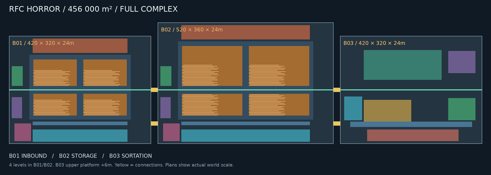

# RFC Horror — карта для Blender

Генератор и собранная сцена комплекса из трёх блоков. Размеры: 420×320×24 м, 520×360×24 м и 420×320×24 м. B01/B02 — четыре уровня; B03 — сортировка с антресолью +6 м.

## Скачать

- [Полный архив — карта, скрипт, текстуры, GLB, планы и отчёты (37 МБ)](https://github.com/PANDORA615/bizon/raw/refs/heads/main/RFC_Horror_bundle.zip)
- [Готовая карта RFC_Horror_Master.blend (7,5 МБ)](https://github.com/PANDORA615/bizon/raw/refs/heads/main/RFC_Horror_Master.blend)
- [Автономный Python-скрипт generate_rfc.py](https://github.com/PANDORA615/bizon/raw/refs/heads/main/generate_rfc.py)
- [Инструкция на русском](README_RU.md)



## Использование

**Blender 4.3+**: откройте `RFC_Horror_Master.blend`. Все 54 PNG-карты для 18 материалов упакованы внутрь. Полная сцена содержит 20 908 объектов с общими мешами, 560 рядов, 42 112 секций и 168 448 адресов ячеек.

Генерация: Scripting → Open → `generate_rfc.py` → Run Script. Скрипт создаёт текстуры локально и не требует скачивания ассетов.

```bash
blender -b --factory-startup --python generate_rfc.py -- --output ./RFC_BUILD --mode full --export
```

Для быстрой итерации: `--mode small` или `--mode medium`.

## Состав

- `textures/` — BaseColor, Roughness и Normal; изображения также встроены в `.blend` и GLB.
- `exports/` — GLB всех трёх блоков.
- `metadata/` — планировка, ячейки, граф навигации, коллайдеры, свет и хоррор-маркеры.
- `previews/` — подписанные планы уровней и общая схема.
- `reports/` и `BUILD_VERIFICATION.json` — результаты проверок и ограничения.

Генерация small/full, упаковка текстур, воспроизводимость, горизонтальные маршруты и обратный импорт B03 GLB в Blender проверены. Это статическая Blender-сцена с метаданными: игровые проходы, импорт в Unity, AI, NavMesh, стриминг и FPS не проверены. Полная игровая приёмка по RFC v3 не заявляется.
